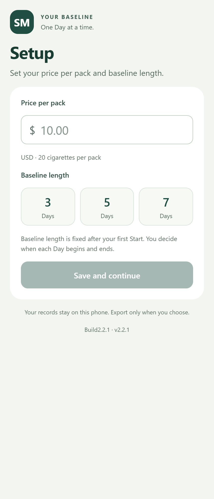
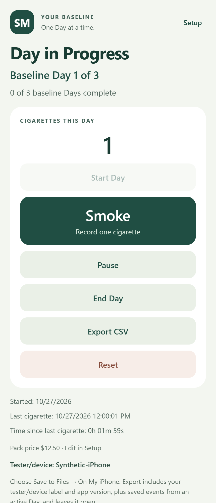

# SM — project showcase

SM is an iPhone app project focused on understanding smoking patterns and making
spending more visible. It begins with an observed baseline and supports tracking
later Days against that starting point.

**Showcase v0.02 · November 10, 2026 · Development on hold**

This showcase contains a [plain-English project overview](PROJECT_OVERVIEW.md),
demonstration screenshots, and the [Build 2.9 validation record](VALIDATION.md).

## Project experience

- Choose a baseline length and record a price per pack.
- Start and end each Day explicitly, with Pause and Resume when needed.
- Record cigarettes and review Day history.
- Keep zero-cigarette Days or repeat attempts according to the user's choice.
- Begin Program Day 1 after baseline collection is complete.
- Review spending and savings, and export records when needed.

## Demonstration screens

These images are interface previews made with invented test data. They contain no
personal smoking records and are not evidence of a completed release.

| Setup | Day in progress |
| --- | --- |
|  |  |

## Development progress

The current milestone covers baseline collection, Day recording, retained history,
and spending and savings views. Functional testing takes place through Expo Go;
regression testing takes place in the installed app. Final installed-app
regression testing and Build 2 sign-off remain open.

## Showcase history

### v0.02 — November 10, 2026

- Added the Build 1 to Build 2 overview and Build 2.9 validation evidence.
- Recorded the development hold and outstanding acceptance work.

### v0.01 — November 5, 2026

- Established a public presentation containing an overview and synthetic screenshots.
- Kept the application implementation and development records private.
- Restricted this repository's tracked files to this overview, its screenshots,
  and the ignore rules that prevent accidental source-code additions.

Future showcase changes receive a new showcase version and an entry in this history.
